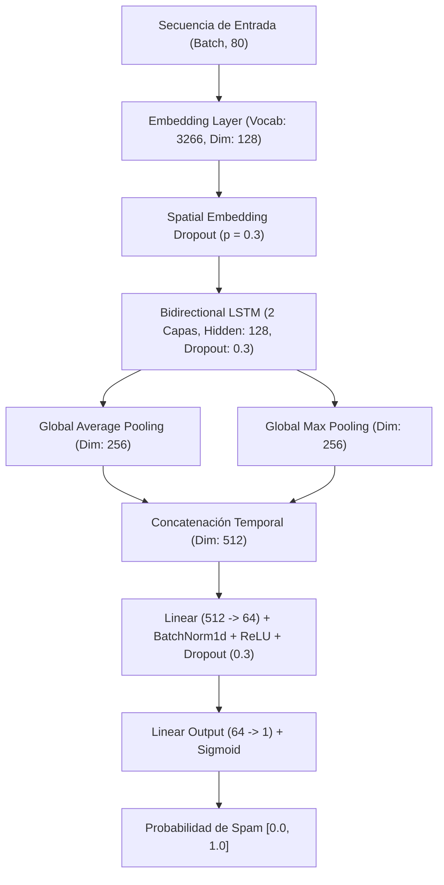

# 🛡️ Detección de Mensajes Spam y Phishing con Deep Learning (BiLSTM)

[](https://www.python.org/)
[](https://pytorch.org/)
[](https://streamlit.io/)
[](https://colab.research.google.com/github/username/deep_learning_nlp_lstm/blob/main/notebooks/deep_learning_spam_lstm.ipynb)

Proyecto integral de **Deep Learning** que implementa una **Red Neuronal Recurrente Bidireccional (BiLSTM)** en **PyTorch** para la clasificación de datos secuenciales de texto, resolviendo el problema de detección en tiempo real de mensajes **Spam** y ataques de **Phishing** (SMS/mensajería).

---

## 📋 Tabla de Contenidos
1. [Descripción del Problema y Dataset](#-1-descripción-del-problema-y-dataset)
2. [Análisis Exploratorio y Preprocesamiento](#-2-análisis-exploratorio-y-preprocesamiento)
3. [División de Datos (Train / Val / Test)](#-3-división-de-datos-train--val--test)
4. [Arquitectura de la Red Neuronal (BiLSTM)](#-4-arquitectura-de-la-red-neuronal-bilstm)
5. [Métricas y Evaluación en Conjunto de Prueba](#-5-métricas-y-evaluación-en-conjunto-de-prueba)
6. [Gráficas del Entrenamiento](#-6-gráficas-del-entrenamiento)
7. [Muestra de 16 Predicciones de Prueba](#-7-muestra-de-16-predicciones-de-prueba)
8. [Estructura del Repositorio](#-8-estructura-del-repositorio)
9. [Instrucciones de Instalación y Ejecución](#-9-instrucciones-de-instalación-y-ejecución)
10. [Aplicación Web con Streamlit](#-10-aplicación-web-con-streamlit)

---

## 📌 1. Descripción del Problema y Dataset

El filtrado de mensajes no deseados (spam) y fraudes por mensajería (smishing/phishing) requiere procesar secuencias de texto breves donde el orden y el contexto de las palabras determinan la intención del mensaje.

- **Dataset seleccionado:** *SMS Spam Collection Dataset* (UCI Machine Learning Repository).
- **Total de registros:** `5,572` mensajes etiquetados.
- **Clases:**
  - `ham` (Mensajes legítimos): **4,825** muestras (`86.59%`).
  - `spam` (Mensajes fraudulentos / publicitarios no deseados): **747** muestras (`13.41%`).

> Documentación ampliada del dataset disponible en [`data/dataset_description.md`](data/dataset_description.md).

---

## 🧹 2. Análisis Exploratorio y Preprocesamiento

El pipeline de limpieza y normalización secuencial implementado en [`src/preprocess.py`](src/preprocess.py) realiza:
1. Conversión a minúsculas.
2. Sustitución semántica de patrones críticos:
   - Enlaces web (`http://...`, `www...`) $\rightarrow$ `<url>`
   - Símbolos monetarios (`£`, `$`, `€`) $\rightarrow$ `<money>`
   - Números telefónicos y códigos de 5+ dígitos $\rightarrow$ `<phone>`
   - Cifras numéricas $\rightarrow$ `<number>`
3. Tokenización por expresiones regulares conservando tokens semánticos.
4. Construcción del vocabulario sobre el conjunto de entrenamiento (`3,266` palabras únicas con frecuencia mínima $\ge 2$), incluyendo tokens especiales `<pad>` (índice `0`) y `<unk>` (índice `1`).
5. Relleno (*post-padding*) y truncado de secuencias a longitud fija `max_len = 80`.

---

## ✂️ 3. División de Datos (Train / Val / Test)

Se aplicó una **partición estratificada** para conservar la proporción exacta de clases en los tres subconjuntos:

| Subconjunto | Porcentaje | Total Muestras | Ham (Legítimo) | Spam (No deseado) | Propósito |
| :--- | :---: | :---: | :---: | :---: | :--- |
| **Entrenamiento (Train)** | `70%` | 3,900 | 3,377 | 523 | Ajuste de pesos y construcción del vocabulario |
| **Validación (Validation)** | `15%` | 836 | 724 | 112 | Monitoreo por época, *Early Stopping* y selección del mejor modelo |
| **Prueba (Test)** | `15%` | 836 | 724 | 112 | Evaluación final totalmente independiente (*Held-Out*) |

---

## 🧠 4. Arquitectura de la Red Neuronal (BiLSTM)

La red neuronal implementada en [`src/model.py`](src/model.py) (`SpamBiLSTM`) combina representaciones densas (*Word Embeddings*), procesamiento recurrente bidireccional de doble capa y agregación global dual (*Mean + Max Pooling*):



- **Total de parámetros entrenables:** `1,110,529`
- **Función de pérdida:** `BCEWithLogitsLoss` con `pos_weight` ponderado para mitigar el desbalance de clases.
- **Optimizador:** `AdamW` (`lr = 0.001`, `weight_decay = 1e-4`) + Scheduler `ReduceLROnPlateau`.

---

## 🎯 5. Métricas y Evaluación en Conjunto de Prueba

Resultados obtenidos al evaluar el mejor checkpoint (`saved_models/best_bilstm_model.pt`) sobre las **836 muestras del conjunto de prueba**:

| Métrica | Valor |
| :--- | :---: |
| **Exactitud Global (Accuracy)** | **98.09%** |
| **Precisión (Precision - Spam)** | **94.44%** |
| **Sensibilidad (Recall - Spam)** | **91.07%** |
| **F1-Score (Spam)** | **92.73%** |
| **F1-Score Macro Promedio** | **95.81%** |
| **Área Bajo la Curva ROC (ROC-AUC)** | **0.9844** |

### Reporte por Clase (Test Set)
```text
                   precision    recall  f1-score   support

   Ham (Legítimo)     0.9863    0.9917    0.9890       724
Spam (No deseado)     0.9444    0.9107    0.9273       112

         accuracy                         0.9809       836
        macro avg     0.9654    0.9512    0.9581       836
     weighted avg     0.9807    0.9809    0.9807       836
```

---

## 📈 6. Gráficas del Entrenamiento

Las gráficas generadas durante el proceso de entrenamiento se encuentran almacenadas en el directorio [`plots/`](plots/):

1. **Curvas de Aprendizaje (Pérdida y Exactitud por Época):** [`plots/training_curves.png`](plots/training_curves.png)
2. **Matriz de Confusión en Prueba:** [`plots/confusion_matrix.png`](plots/confusion_matrix.png)
3. **Distribución Estratificada de Clases:** [`plots/class_distribution.png`](plots/class_distribution.png)

---

## 📋 7. Muestra de 16 Predicciones de Prueba

A continuación se presentan **16 predicciones reales verificadas** sobre el subconjunto de prueba (almacenadas en [`saved_models/sample_predictions.json`](saved_models/sample_predictions.json)):

| # | Mensaje SMS (Conjunto de Prueba) | Etiqueta Real | Predicción BiLSTM | Prob. Spam | Resultado |
| :-: | :--- | :---: | :---: | :---: | :---: |
| 1 | *URGENT! We are trying to contact U. Todays draw shows that you have won a £800 prize GUARANTEED...* | `spam` | `spam` | `99.95%` | ✅ Acierto |
| 2 | *FREE entry into our £250 weekly comp just send the word WIN to 80086 NOW. 18 T&C www.txttowin.co.uk* | `spam` | `spam` | `99.98%` | ✅ Acierto |
| 3 | *This msg is for your mobile content order It has been resent as previous attempt failed...* | `spam` | `spam` | `97.33%` | ✅ Acierto |
| 4 | *Quite lor. But dun tell him wait he get complacent...* | `ham` | `ham` | `0.37%` | ✅ Acierto |
| 5 | *Okie* | `ham` | `ham` | `0.05%` | ✅ Acierto |
| 6 | *Ü go home liao? Ask dad to pick me up at 6...* | `ham` | `ham` | `0.08%` | ✅ Acierto |
| 7 | *Aight I've been set free, think you could text me dullards address?* | `ham` | `ham` | `1.52%` | ✅ Acierto |
| 8 | *I have no money 4 steve mate! !* | `ham` | `ham` | `0.32%` | ✅ Acierto |
| 9 | *Claim a 200 shopping spree, just call 08717895698 now! Have you won! MobStoreQuiz10ppm* | `spam` | `spam` | `99.88%` | ✅ Acierto |
| 10 | *Cheers for the card ... Is it that time of year already?* | `ham` | `ham` | `0.47%` | ✅ Acierto |
| 11 | *Please call our customer service representative on FREEPHONE 0808 145 4742 between 9am-11pm as you have WON a guaranteed £1000 cash or £5000 prize!* | `spam` | `spam` | `99.95%` | ✅ Acierto |
| 12 | *Ur cash-balance is currently 500 pounds - to maximize ur cash-in now send CASH to 86688 only 150p/msg...* | `spam` | `spam` | `99.91%` | ✅ Acierto |
| 13 | *staff.science.nus.edu.sg/~phyhcmk/teaching/pc1323* | `ham` | `ham` | `2.48%` | ✅ Acierto |
| 14 | *Only if you promise your getting out as SOON as you can. And you'll text me in the morning to let me know you made it in ok.* | `ham` | `ham` | `0.36%` | ✅ Acierto |
| 15 | *Bought one ringtone and now getting texts costing 3 pound offering more tones etc* | `spam` | `ham` | `10.04%` | ❌ Fallo |
| 16 | *Do you want 750 anytime any network mins 150 text and a NEW VIDEO phone for only five pounds per week call 08000776320 now or reply for delivery Tomorrow* | `spam` | `spam` | `99.93%` | ✅ Acierto |

---

## 📂 8. Estructura del Repositorio

```text
deep_learning_nlp_lstm/
│
├── data/
│   ├── spam.csv                        # Dataset completo (5,572 mensajes etiquetados)
│   ├── sms.tsv                         # Archivo original tabulado
│   └── dataset_description.md          # Documentación y diccionario de datos
│
├── notebooks/
│   └── deep_learning_spam_lstm.ipynb   # Notebook completo de experimentación (Google Colab / Jupyter)
│
├── src/
│   ├── __init__.py
│   ├── preprocess.py                   # Limpieza, tokenización, Vocabulary y DataLoaders
│   ├── model.py                        # Definición de la arquitectura neuronal SpamBiLSTM
│   ├── train.py                        # Script de entrenamiento, validación, evaluación y gráficas
│   └── predict.py                      # Módulo de inferencia individual, por lote y CLI
│
├── saved_models/
│   ├── best_bilstm_model.pt            # Pesos del modelo BiLSTM entrenado
│   ├── vocab.json                      # Vocabulario serializado (3,266 tokens)
│   ├── model_config.json               # Hiperparámetros del modelo
│   ├── metrics.json                    # Métricas de evaluación en el conjunto de prueba
│   ├── training_history.json           # Historial época por época (Loss, Accuracy, F1)
│   └── sample_predictions.json         # Predicciones detalladas de prueba
│
├── plots/
│   ├── training_curves.png             # Gráfica de Loss y Accuracy (Train vs Val)
│   ├── confusion_matrix.png            # Matriz de confusión en Test Set
│   └── class_distribution.png          # Distribución de clases en Train, Val y Test
│
├── app.py                              # Aplicación web interactiva en Streamlit
├── requirements.txt                    # Dependencias del proyecto
├── .gitignore                          # Archivos excluidos del control de versiones
└── README.md                           # Documentación principal e instrucciones
```

---

## 🚀 9. Instrucciones de Instalación y Ejecución

### Paso 1: Clonar el repositorio
```bash
git clone <URL_DEL_REPOSITORIO>
cd deep_learning_nlp_lstm
```

### Paso 2: Crear un entorno virtual e instalar dependencias
```bash
# Crear entorno virtual (en Windows se recomienda ruta corta si aplica límite MAX_PATH)
python -m venv .venv

# Activar en Windows (PowerShell):
.\.venv\Scripts\Activate.ps1

# Activar en Linux / macOS:
source .venv/bin/activate

# Instalar dependencias:
pip install -r requirements.txt
```

### Paso 3: Entrenar el modelo desde cero (Opcional, el modelo entrenado ya está incluido)
```bash
python src/train.py --epochs 8 --batch_size 32 --lr 0.001
```

### Paso 4: Realizar predicciones desde la terminal (CLI)
```bash
python src/predict.py --text "WINNER!! You have been selected to receive a £900 prize reward! Call 09061701461 now."
```

---

## 🌐 10. Aplicación Web con Streamlit

Para iniciar la interfaz gráfica interactiva que carga el modelo entrenado y permite clasificar mensajes en tiempo real o por lotes (CSV):

```bash
streamlit run app.py
```

### Funcionalidades de la Aplicación Streamlit:
1. **🔍 Analizador en Tiempo Real:** Ingrese cualquier texto o utilice los botones de ejemplo rápido para obtener la etiqueta predicha (`SPAM` / `HAM`), probabilidad calibrada, nivel de confianza y desglose de tokens identificados.
2. **📊 Métricas & Arquitectura:** Visualice las curvas de entrenamiento, la matriz de confusión, el balance de subconjuntos y el diagrama de la red neuronal BiLSTM.
3. **📋 Predicciones de Prueba (10+):** Explore de forma interactiva las predicciones sobre el conjunto de prueba con filtros dinámicos.
4. **📁 Predicción por Lote (CSV):** Suba un archivo CSV con múltiples mensajes para clasificarlos masivamente y descargar los resultados enriquecidos.
